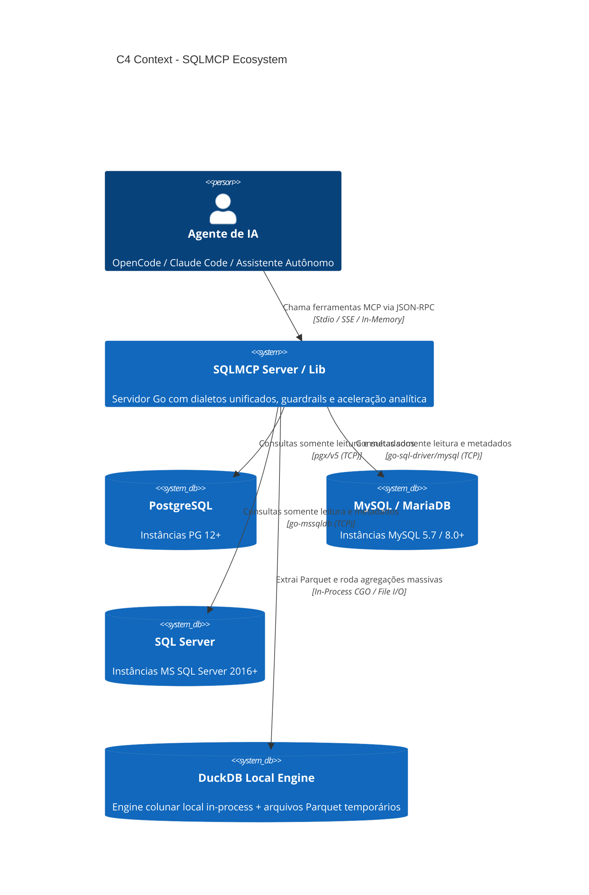

# Architecture Design Document (ADD) - SQLMCP
## Servidor MCP de Banco de Dados Multi-Dialeto de Alto Desempenho

- **Status:** Aprovado
- **Versão:** 1.0.0
- **Data:** 2026-10-14
- **Autor:** Arquiteto de Software e Soluções Sênior

---

## 1. Visão Geral e Objetivos do Sistema

O **SQLMCP** é um servidor compatível com a especificação **Model Context Protocol (MCP)**, desenvolvido em **Go**, projetado para atuar como ponte semântica, segura e ultra-rápida entre agentes de Inteligência Artificial (LLMs) e bancos de dados relacionais corporativos: **PostgreSQL**, **MySQL** e **Microsoft SQL Server**.

O projeto atende a dois cenários operacionais idênticos através da mesma base de código:
1. **Modo Standalone / Servidor MCP:** Executável nativo que comunica via Stdio ou SSE/HTTP com ferramentas como OpenCode, Claude Code, Cursor, etc.
2. **Modo Biblioteca Embutida (Vendorizável):** Módulo Go exportável (`pkg/engine`) que permite a qualquer aplicação Go instanciar a camada semântica e executar consultas diretamente sem overhead de sub-processos.

---

## 2. Requisitos Não Funcionais (NFRs) e Guardrails

| Categoria | Especificação |
|---|---|
| **Segurança** | Operações exclusivamente **Read-Only** (`SELECT`, `EXPLAIN`). Bloqueio proativo de DDL/DML na camada AST antes de tocar no banco. |
| **Proteção de Janela de Contexto** | Limite padrão de 500 linhas por query (teto absoluto de 2.000). Truncamento de colunas com texto longo (>4KB). |
| **Resiliência e Timeout** | Timeout estrito cancelável via contexto (`15s` default) para prevenir locks e queries zumbis. |
| **Dialetos Nativos** | Abstração em interface única `Dialect` com implementações específicas para PG, MySQL e MSSQL. |
| **Aceleração Analítica** | Extração de fatias para arquivos **Parquet** e consultas analíticas ultrarrápidas locais via **DuckDB**. |
| **Visualização** | Geração instantânea de diagramas de entidade-relacionamento em **Mermaid ERD**. |

---

## 3. Arquitetura do Sistema (C4 Model)

### 3.1. C4 Nível 1 - Diagrama de Contexto



---

### 3.2. C4 Nível 2 - Diagrama de Contêineres e Componentes Internos

```mermaid
C4Container
    title C4 Container - Arquitetura Interna do SQLMCP (Go)

    Container_Boundary(c1, "SQLMCP Core Package")
        Component(trans, "Transport Handler", "mcp-go (Stdio / SSE)", "Interpreta requisições MCP Tools/Resources")
        Component(guard, "Security & Guardrails Guard", "AST Validator & Limiter", "Garante Read-Only, Timeout e Max Rows")
        Component(conn, "Connection Pool Manager", "Go sync.Map & sql.DB", "Gerencia perfis estáticos e dinâmicos")
        Component(meta, "Schema & Graph Engine", "Dialect-aware Inspector", "Gera catálogo unificado, FKs e Mermaid ERD")
        Component(duck, "DuckDB Acceleration Engine", "go-duckdb & Parquet Writer", "Gerencia extração de fatias e queries locais")
        Component(dialect_if, "Dialect Interface", "Go Interface", "Contrato comum para PG, MySQL e MSSQL")
    Container_Boundary_End()

    Rel(trans, guard, "Valida input antes da execução")
    Rel(guard, conn, "Obtém conexão correspondente")
    Rel(conn, dialect_if, "Delega operações ao dialeto correto")
    Rel(meta, dialect_if, "Lê information_schema / sys.tables")
    Rel(guard, duck, "Roteia queries analíticas para Parquet quando solicitado")
```

---

## 4. Contratos das Ferramentas MCP (Tools)

O SQLMCP expõe o seguinte catálogo de ferramentas padronizadas para os agentes:

### 1. `list_databases`
- **Descrição:** Lista os bancos ou esquemas acessíveis na conexão/perfil.
- **Parâmetros:** `{ db_alias?: string }`

### 2. `list_tables`
- **Descrição:** Lista tabelas e views com contagem aproximada de linhas e tipo.
- **Parâmetros:** `{ db_alias?: string, schema?: string, include_views?: boolean }`

### 3. `describe_table`
- **Descrição:** Fornece o esquema detalhado de uma tabela: colunas, tipos primitivos, nulidade, chaves primárias, índices e comentários.
- **Parâmetros:** `{ table_name: string, db_alias?: string, schema?: string }`

### 4. `get_relations`
- **Descrição:** Mapeia as Foreign Keys de entrada e saída para que o agente saiba exatamente como estruturar os `JOIN`s corretos.
- **Parâmetros:** `{ table_name?: string, db_alias?: string, schema?: string }`

### 5. `generate_mermaid_erd`
- **Descrição:** Gera o diagrama ERD em formato Mermaid compatível com renderização visual, focando no banco completo ou num conjunto de tabelas selecionadas.
- **Parâmetros:** `{ tables?: string[], db_alias?: string, schema?: string }`

### 6. `execute_query`
- **Descrição:** Executa com segurança uma consulta `SELECT` com limite rígido de linhas e timeout.
- **Parâmetros:** `{ query: string, db_alias?: string, max_rows?: number }`

### 7. `explain_query`
- **Descrição:** Devolve o plano de execução da consulta utilizando o comando nativo do dialeto (`EXPLAIN ANALYZE`, `EXPLAIN`, `SHOWPLAN_ALL`).
- **Parâmetros:** `{ query: string, db_alias?: string }`

### 8. `sample_table`
- **Descrição:** Traz uma amostra representativa de N linhas (padrão: 5 linhas) para o agente entender o formato real dos dados.
- **Parâmetros:** `{ table_name: string, limit?: number, db_alias?: string, schema?: string }`

### 9. `stage_to_parquet`
- **Descrição:** Extrai uma fatia de dados ou resultado de consulta volumosa para um arquivo Parquet local, preparando para análise acelerada sem onerar o banco de produção.
- **Parâmetros:** `{ query: string, stage_name: string, db_alias?: string, limit?: number }`

### 10. `query_duckdb`
- **Descrição:** Executa uma consulta analítica rápida em SQL padrão sobre as tabelas e arquivos Parquet estagiados localmente via DuckDB.
- **Parâmetros:** `{ query: string, stage_name?: string, max_rows?: number }`

### 11. `connect_database`
- **Descrição:** Permite registrar dinamicamente uma nova conexão em runtime para a sessão do agente.
- **Parâmetros:** `{ db_alias: string, engine: "postgres" | "mysql" | "sqlserver", connection_string: string }`

---

## 5. Estrutura de Diretórios do Projeto em Go

```text
sqlmcp/
├── cmd/
│   └── sqlmcp/
│       └── main.go                 # Ponto de entrada do CLI executável MCP (Stdio/SSE)
├── pkg/
│   ├── sqlmcp/                     # Pacote público para vendorização/uso como biblioteca
│   │   ├── client.go
│   │   └── options.go
│   └── dialect/                    # Contratos e tipos de dialeto
│       ├── dialect.go
│       ├── postgres.go
│       ├── mysql.go
│       └── sqlserver.go
├── internal/
│   ├── config/                     # Leitura de configs e profiles estáticos
│   ├── pool/                       # Gerenciador de conexões dinâmicas e estáticas
│   ├── security/                   # Validador de AST, leitor Read-Only e limiters
│   ├── schema/                     # Inspetor de metadados, Foreign Keys e gerador Mermaid
│   ├── analytics/                  # Integração com DuckDB e exportador Parquet
│   └── mcp/                        # Registrador de ferramentas e handlers mcp-go
├── .opencode/
│   └── skills/
│       └── dba-fullstack/          # Skill de governança e operação do SQLMCP para agentes
│           └── SKILL.md
├── docs/
│   ├── architecture/
│   │   └── ADD.md
│   └── adr/
│       ├── 0001-stack-go-mcp-vendorizavel.md
│       ├── 0002-seguranca-read-only-guardrails.md
│       └── 0003-aceleracao-analitica-duckdb-parquet.md
├── go.mod
├── go.sum
└── Makefile
```

---

## 6. Agentes de IA & Skill dba-fullstack

Para maximizar o valor entregue pelas 11 ferramentas do SQLMCP, o projeto disponibiliza a skill especializada **`dba-fullstack`** (armazenada em `.opencode/skills/dba-fullstack/SKILL.md`).
Esta skill orienta os agentes a:
- Diagnosticar e resolver queries lentas via `explain_query` identificando nós caros por dialeto.
- Navegar pelo catálogo sem estourar janelas de contexto com `describe_table` e `get_relations`.
- Identificar quando uma tabela possui volumetria massiva (>1M de linhas) e acionar a aceleração local via `stage_to_parquet` e `query_duckdb`.
- Gerar diagramas visuais automáticos com `generate_mermaid_erd`.
