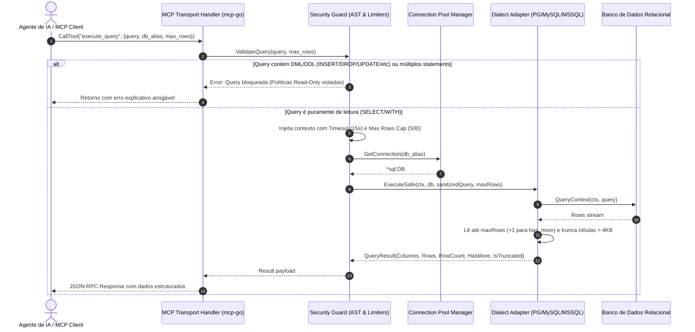
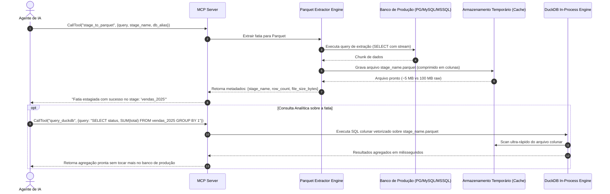

# Diagramas de Sequência e Fluxos Operacionais - SQLMCP

## 1. Fluxo de Execução Segura Read-Only (`execute_query`)

Este fluxo ilustra as barreiras de segurança atômicas pelas quais uma query passa antes de ser enviada ao banco de dados:

---

## 2. Fluxo de Aceleração Analítica Local (`stage_to_parquet` + `query_duckdb`)

Este fluxo é acionado quando o agente identifica que a análise sobrecarregaria o banco OLTP ou excederia os limites de contexto:

